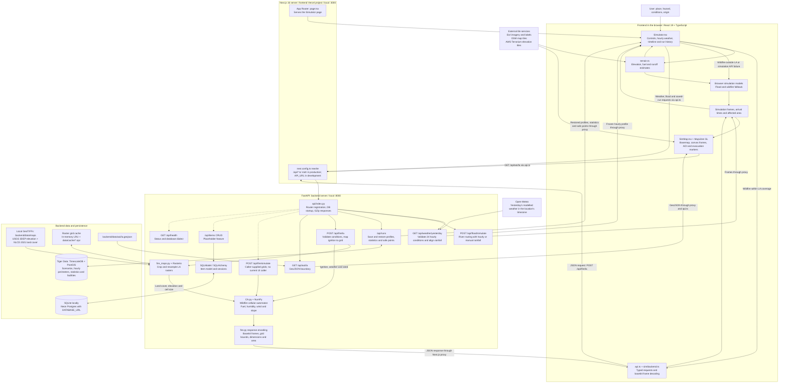

# CA-lamity architecture

This diagram follows the current code, including the browser simulation fallback. Arrows show requests, data flow, and module calls; dashed arrows show supporting API features outside the main simulator flow.

## Main request flow

1. Next.js serves `page.tsx`, which renders the React `Simulator`. The browser loads terrain tiles directly from external providers and builds its local terrain grid.
2. For a wildfire whose bounds fit inside the supported LA region, `runBackendWildfire()` sends weather, ignition coordinates, bounds, resolution and seed to `/api/fire/la`. Next.js forwards the request to FastAPI at `https://api.ca-lamity.live` in production, or `API_URL` in development (default: `http://127.0.0.1:8000`).
3. `fire_maps.py` loads cached grids or resamples the local elevation and land-cover GeoTIFFs. `CA.py` derives fuel from land cover and computes fire spread using humidity, wind and elevation slope.
4. FastAPI returns base64 byte frames and grid metadata as JSON, with GZip for sufficiently large responses. The browser decodes the frames into `Uint8Array`s, calculates first-arrival times and renders playback using a canvas overlay on MapLibre.
5. Floods send the browser's terrain grid to `/api/flood/simulate` for Python river routing. Wildfire outside backend coverage runs in browser models. If a simulation API call fails, the UI reports it and uses the corresponding browser model.
6. Choosing yesterday's weather fetches `/api/weather/yesterday` using the selected coordinates. The hourly wind and humidity drive wildfire; liquid rainfall drives floods. Soil saturation remains manual. Profiles are saved with wildfire and flood scenarios under the existing JSON parameters, so replay uses the same conditions.

## Supporting features and deployment

- The LA boundary comes from `/api/aoi/la`. It requires `backend/data/aoi/la.geojson`; the endpoint returns 404 if that file is absent.
- `/api/items` and the SQLModel `Item` table are scaffold CRUD features. The current home page renders the simulator; it does not mount `ItemsPanel` or `ApiStatus`. Wildfire and flood scenarios, hourly perimeters and statistics are stored in Tiger Data. Simulation frames stay in React state. Evacuation facilities come from OpenStreetMap and spatial queries select safe points.
- `/api/fire/simulate` accepts caller-provided grids and invokes the same Python engine. The current frontend client only calls `/api/fire/la`.
- The README describes a Vultr backend and Vercel frontend; backend Vercel configuration is also present. Production requests use `https://api.ca-lamity.live`; `API_URL` can override the development backend. `DATABASE_URL` selects Postgres. Without a database URL, local development uses `backend/local.db`; Vercel falls back to ephemeral `/tmp/app.db`. Tiger Data features require TimescaleDB and PostGIS.
- LA raster files are ignored by Git and must be supplied separately. The loader currently writes cache files under `backend/data/cache`; Vercel deployment needs writable cache handling (such as `/tmp`) or provisioned cache files because the application directory is read-only.

## Code references

| Responsibility | Files |
| --- | --- |
| Page and simulation controls | [page.tsx](../frontend/src/app/page.tsx), [Simulator.tsx](../frontend/src/components/terrashift/Simulator.tsx) |
| Map rendering | [SimMap.tsx](../frontend/src/components/terrashift/SimMap.tsx) |
| API client and proxy | [api.ts](../frontend/src/lib/api.ts), [backend.ts](../frontend/src/lib/sim/backend.ts), [next.config.ts](../frontend/next.config.ts) |
| Browser terrain and models | [terrain.ts](../frontend/src/lib/sim/terrain.ts), [models.ts](../frontend/src/lib/sim/models.ts) |
| FastAPI entry point and fire routes | [index.py](../backend/api/index.py), [fire.py](../backend/api/routes/fire.py) |
| Python wildfire engine and raster loading | [CA.py](../backend/CA.py), [fire_maps.py](../backend/fire_maps.py) |
| Hourly weather and provider integration | [weather.py](../backend/api/routes/weather.py), [weather schemas](../backend/api/weather.py), [weather.ts](../frontend/src/lib/sim/weather.ts) |
| River floods and saved scenarios | [flood.py](../backend/flood.py), [runs.py](../backend/api/routes/runs.py), [tiger.py](../backend/api/tiger.py) |
| AOI and persistence | [aoi.py](../backend/api/routes/aoi.py), [items.py](../backend/api/routes/items.py), [db.py](../backend/api/db.py), [models.py](../backend/api/models.py) |
